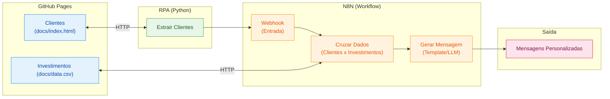

# Assistente de Investimentos com RPA e IA Generativa

## Sobre o projeto

Este projeto foi desenvolvido como parte do desafio **Criando um Assistente de Investimentos com RPA e IA Generativa**, com o objetivo de integrar extração de dados, automação de processos, processamento de informações e inteligência artificial para produzir comunicações personalizadas para clientes fictícios.

A solução utiliza Python para coletar os dados de uma página web, n8n para orquestrar o fluxo e um modelo de linguagem acessado por meio da API da Groq para gerar mensagens personalizadas. Ao final, as mensagens são enviadas por e-mail usando SMTP.

> Os dados e as recomendações deste projeto são demonstrativos e destinados a fins educacionais. As mensagens geradas não constituem aconselhamento financeiro.

## Demonstração do fluxo completo

O vídeo abaixo demonstra o workflow de ponta a ponta, desde a extração dos dados até o processamento e o envio das mensagens:

**[Assistir ao vídeo do workflow completo no Google Drive](https://drive.google.com/file/d/18x1R_lM91XpuIOWWDbgncz10-0U-EVlH/view?usp=sharing)**

## Objetivos

- Extrair os dados dos clientes de uma página web com Python e BeautifulSoup.
- Enviar os dados coletados para um webhook do n8n.
- Consultar e processar a base de opções de investimento disponibilizada em CSV.
- Relacionar o perfil e o saldo de cada cliente às opções elegíveis.
- Gerar e-mails personalizados com auxílio de um modelo de linguagem.
- Enviar as mensagens por SMTP, utilizando os campos de destinatário, assunto e conteúdo gerados no fluxo.

## Arquitetura do Projeto



## Tecnologias e ferramentas

| Tecnologia | Utilização no projeto |
|---|---|
| **Python** | Execução do notebook de extração e envio dos dados ao webhook. |
| **BeautifulSoup** | Leitura e extração dos dados da tabela HTML de clientes. |
| **GitHub Pages** | Hospedagem da página simulada de clientes e do arquivo CSV de investimentos. |
| **n8n self-hosted via Node.js** | Orquestração do workflow local, transformação dos dados e integração entre as etapas. |
| **Cloudflare Tunnel / Quick Tunnel** | Exposição temporária do serviço local do n8n à internet para que o notebook Python pudesse acessar o webhook. |
| **Groq API** | Acesso a um modelo de linguagem com a oferta gratuita de uso disponibilizada pela plataforma, respeitando seus limites de utilização. |
| **SMTP** | Envio das mensagens personalizadas por meio do nó **Send Email** do n8n. |

## Como o fluxo funciona

1. **Extração dos clientes:** o notebook Python acessa a página de clientes e extrai informações como nome, e-mail, saldo e perfil de investidor.
2. **Exposição do webhook:** como o n8n está sendo executado localmente por meio do Node.js, o Cloudflare Tunnel cria uma URL pública que encaminha as requisições para o serviço local durante os testes.
3. **Recebimento dos dados:** o webhook do n8n recebe os dados enviados pelo notebook Python.
4. **Leitura da base de investimentos:** o workflow consulta o CSV publicado no GitHub Pages e transforma seu conteúdo em registros utilizáveis pelo fluxo.
5. **Processamento e recomendação:** o código JavaScript no n8n compara o perfil do cliente e o saldo disponível com os investimentos compatíveis, considerando o valor mínimo de aplicação.
6. **Preparação dos dados:** os resultados são organizados em itens individuais, um para cada cliente, com os dados necessários para a geração da mensagem.
7. **Geração do e-mail com IA:** o modelo de linguagem acessado pela Groq recebe os dados de cada cliente e a recomendação correspondente. O prompt orienta a geração de um assunto, de um corpo em texto simples e de uma versão HTML, sem prometer ganhos ou garantias.
8. **Normalização e validação:** a resposta do modelo é convertida em campos estruturados. O workflow verifica se o endereço de e-mail está presente e tem formato válido antes de prosseguir.
9. **Envio da mensagem:** o nó **Send Email** utiliza credenciais SMTP para encaminhar a mensagem ao destinatário definido no item.

## Decisões técnicas e aprendizados

### 1. Cloudflare para expor o n8n local

O n8n foi executado localmente por meio do Node.js, sem uma instância hospedada publicamente. Para permitir que o notebook Python acessasse o webhook, foi utilizado o **Cloudflare Tunnel**, na modalidade Quick Tunnel durante os testes.

Essa abordagem evita a necessidade de configurar diretamente o encaminhamento de portas do roteador. A URL do túnel é usada como endereço público de acesso ao webhook enquanto o túnel está ativo.

**Observações importantes:**
- A URL de um Quick Tunnel é temporária e pode mudar quando o túnel é reiniciado.
- Para utilizar o fluxo, o processo do n8n e o túnel precisam estar em execução.
- A URL pública do webhook deve ser tratada como um ponto de entrada exposto à internet. Em aplicações reais, devem ser consideradas autenticação, validação de entrada e outras medidas de segurança.
- O endpoint de teste do n8n requer que o workflow esteja aguardando uma chamada de teste; para execuções regulares, deve-se usar o webhook de produção com o workflow ativo.

### 2. Groq como provedor de modelo de linguagem

Em vez de depender de créditos pagos da API da OpenAI, o desenvolvimento utiliza a **Groq API**, aproveitando a faixa gratuita disponibilizada pelo provedor, sujeita a limites e condições de uso.

O modelo recebe os dados já processados pelo workflow e produz o texto do e-mail em formato estruturado. O prompt inclui instruções para personalizar a mensagem com base no cliente atual, preservar o endereço de e-mail recebido e evitar promessas de rentabilidade.

A disponibilidade de modelos, limites gratuitos e condições da API pode mudar. Consulte a documentação oficial da Groq para verificar os limites vigentes.

### 3. Envio por SMTP com o nó Send Email

Para enviar as mensagens, foi utilizado o nó **Send Email** do n8n, em vez do nó específico do Gmail. Essa alternativa permite configurar um servidor SMTP e não exige a configuração de credenciais OAuth2 específicas do Gmail.

O nó utiliza os campos normalizados pelo workflow:
- **To Email:** endereço do cliente;
- **Subject:** assunto personalizado;
- **HTML:** conteúdo HTML do e-mail.

No caso de uma conta Gmail, a configuração SMTP normalmente utiliza `smtp.gmail.com`. Dependendo das configurações da conta, pode ser necessário usar uma senha de app com a verificação em duas etapas ativada. As credenciais devem ser armazenadas nas credenciais do n8n e nunca inseridas diretamente no código ou publicadas no repositório.

### 4. Tratamento individual dos clientes

Os resultados do processamento são convertidos em itens individuais antes da etapa de geração das mensagens. Dessa forma, o modelo pode produzir uma mensagem por cliente, em vez de reutilizar os dados de um exemplo fixo.

O endereço do destinatário deve ser preservado a partir dos dados originais do cliente. Como a IA é usada para redigir a mensagem — e não como fonte cadastral —, é importante validar se o campo de e-mail continua preenchido antes do envio.

## Estrutura do repositório

## Estrutura do Repositório

```
📁 dio-lab-assistente-investimentos-rpa-n8n/
├── 📄 README.md
├── 📁 src/
│   └── 📄 extrair_clientes.ipynb   # ✅ Notebook Python
├── 📁 n8n/
│   └── 📄 workflow.json            # 🎯 O arquivo JSON do desafio
└── 📁 docs/
    ├── 📄 index.html               # ✅ Página de clientes (herdado da origem)
    └── 📄 data.csv                 # ✅ Opções de investimento (herdado da origem)
```

## Como executar

1. Instale e inicie o n8n localmente.
2. Importe o workflow exportado para o n8n e confira as conexões e credenciais necessárias.
3. Configure a credencial de acesso à API da Groq no nó de modelo de linguagem, utilizando o endpoint e as instruções da documentação do provedor.
4. Configure as credenciais SMTP no nó **Send Email**.
5. Inicie um Cloudflare Tunnel para expor temporariamente a porta local do n8n e obtenha a URL pública.
6. Configure no notebook Python a URL do webhook correspondente ao modo de execução (teste ou produção).
7. Execute o notebook para extrair e enviar os dados.
8. Verifique a saída de cada etapa do workflow, confirme se cada item contém o endereço correto e teste primeiro com um destinatário controlado antes de enviar para a lista completa.

> **Segurança:** não publique chaves de API, senhas SMTP, senhas de aplicativos ou URLs privadas de execução. Antes de compartilhar o arquivo exportado do workflow, revise se ele contém dados sensíveis ou referências a credenciais pessoais.

## Referências

- [Repositório original do desafio — DIO](https://github.com/digitalinnovationone/dio-lab-assistente-investimentos-rpa-n8n)
- [Documentação do n8n](https://docs.n8n.io/)
- [Documentação do nó Webhook do n8n](https://docs.n8n.io/integrations/builtin/core-nodes/n8n-nodes-base.webhook/)
- [Documentação do nó Send Email do n8n](https://docs.n8n.io/integrations/builtin/core-nodes/n8n-nodes-base.emailSend/)
- [Cloudflare Tunnel — documentação oficial](https://developers.cloudflare.com/cloudflare-one/connections/connect-networks/)
- [Cloudflare Quick Tunnels — documentação oficial](https://developers.cloudflare.com/cloudflare-one/connections/connect-networks/do-more-with-tunnels/trycloudflare/)
- [Groq API — documentação oficial](https://console.groq.com/docs/quickstart)
- [Groq — limites de utilização](https://console.groq.com/docs/rate-limits)
- [SMTP — configuração de envio no n8n](https://docs.n8n.io/integrations/builtin/credentials/sendemail/)
- [BeautifulSoup — documentação](https://www.crummy.com/software/BeautifulSoup/bs4/doc/)
- [GitHub Pages — documentação](https://docs.github.com/pages)

---

Desenvolvido como exercício prático de integração entre **RPA, automação de workflows e IA generativa**.
